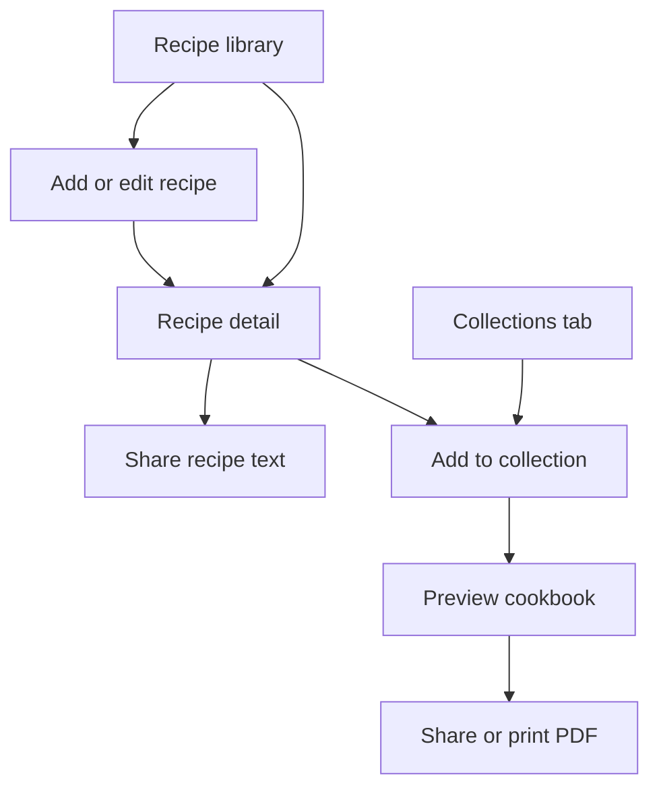

# Family Recipe App Build Plan

**Working draft · November 17, 2026**

Build a local iPhone prototype in SwiftUI and SwiftData. The first milestone is complete when you can save a real recipe, close the app, reopen it, and make an edit that persists.

## App flow

Use two tabs, **Recipes** and **Collections**. The recipe detail hosts sending, editing, and adding to a collection. The collection detail hosts recipe order and cookbook preview.

## Build milestones

| Milestone | Build | Verify on device or simulator |
|---|---|---|
| 1. Save a recipe | Recipe list, detail, editor, and local persistence. Require a title on save and preserve familiar ingredient wording. | Add and edit your shoyu chicken recipe. Cancel a separate edit and check that the original stays saved. |
| 2. Make a collection | Add and remove recipes, set the recipe order, and search the library by title. | Add the same recipe to two collections, then remove it from one. Reopen the app and check the other collection and saved order. |
| 3. Send a recipe | Format title, servings, ingredients, steps, and any family note as readable text. Open the system share sheet. | Send to a family member and check what arrives, including line breaks and ingredient amounts. |
| 4. Export a cookbook | Generate a PDF with a cover, page numbers, and body text that can flow across pages. Preview the generated file and share or print that same file. | Check an empty collection, a short cookbook, and a recipe long enough to span several pages. Print one sample page. |
| 5. Run a family beta | Give testers the tasks in the product brief. Record where they pause and what they ask for. | Fix any blocker that prevents a family from saving, sending, or printing with their own recipes. |

## Starting data model

- **Recipe** holds a stable ID, title, optional servings and family note, ordered ingredient lines and steps, and an updated date. Start with one raw text entry per ingredient line so the editor accepts amounts like “to taste.”
- **Collection** holds a stable ID and a name. **CollectionEntry** associates a recipe with a collection and stores its position. This lets each cookbook order the same recipe independently. Prevent duplicate entries within one collection.
- When deleting a collection, remove its entries and retain its recipes. When deleting a recipe, remove its entries from every collection and ask for confirmation from the recipe screen.

## Development workflow

Use a separate branch for each roadmap item. The default completion path for a small, self-contained item is: run the full tests and build, merge locally into `main`, rerun the tests on the merged result, push `main`, and delete the completed branch. Pull only when synchronizing remote changes before the merge.

Use a pushed feature branch and pull request for persistence or migration changes, security-sensitive work, release-configuration changes, or anything that needs another person’s review.

## First build session

Create a SwiftUI project with a persistent SwiftData container. Implement only the recipe list, a sheet for adding and editing, and a simple detail view. Enter your own recipe and verify that edits persist after relaunch. Use that same recipe later to test sharing and make the first cookbook sample.
